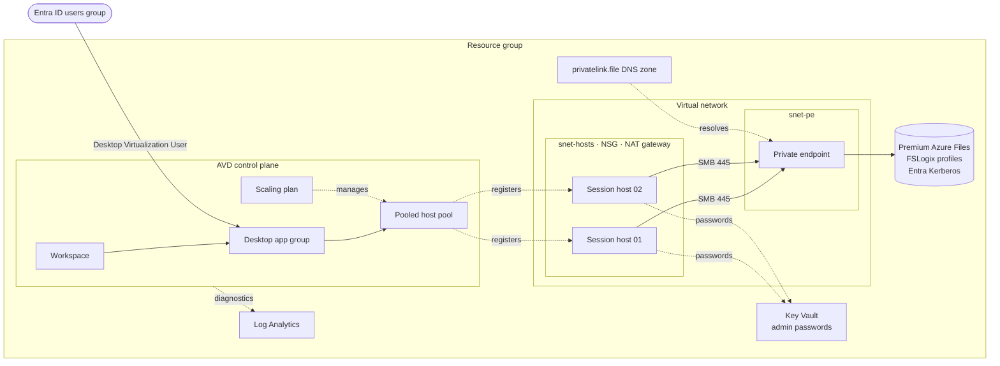

# Azure Virtual Desktop on Azure Verified Modules

A production-shaped Azure Virtual Desktop (AVD) deployment built almost entirely from
[Azure Verified Modules (AVM)](https://aka.ms/avm). One root module serves every
environment: `dev` and `prod` differ only in a tfvars file and a backend file, and
tenant-specific values come from environment variables.

## What it deploys



| Area | Design choice |
|---|---|
| **Identity** | Session hosts are Entra ID-joined (no domain controllers) with single sign-on (`enablerdsaadauth`), and Intune enrollment is optional. |
| **Profiles** | FSLogix on Premium ZRS Azure Files, reachable only through a private endpoint. Microsoft Entra Kerberos handles auth, and shared keys are disabled. |
| **Networking** | No public IPs on hosts and no inbound NSG rules (AVD uses reverse connect). Outbound goes through a NAT gateway because default outbound access is off. |
| **Session hosts** | Trusted Launch (Secure Boot + vTPM), encryption at host, spread across availability zones. A unique local admin password per host is stored in Key Vault. |
| **Scaling** | A weekday scaling plan ramps hosts up and down, and Start VM on Connect wakes a host for the first user. |
| **Observability** | Host pool, app group, workspace, scaling plan and Key Vault all send `allLogs` to Log Analytics through one shared diagnostic settings block. |
| **Host config** | Run commands configure FSLogix and Entra Kerberos first, then install the AVD agent, so no user lands on an unconfigured host. |

### Modules used

| Resource | Module |
|---|---|
| Resource group | `Azure/avm-res-resources-resourcegroup` |
| Virtual network and subnets | `Azure/avm-res-network-virtualnetwork` |
| Network security group | `Azure/avm-res-network-networksecuritygroup` |
| NAT gateway | `Azure/avm-res-network-natgateway` |
| Private DNS zone | `Azure/avm-res-network-privatednszone` |
| Storage account (FSLogix) | `Azure/avm-res-storage-storageaccount` |
| Key Vault | `Azure/avm-res-keyvault-vault` |
| Log Analytics | `Azure/avm-res-operationalinsights-workspace` |
| Host pool | `Azure/avm-res-desktopvirtualization-hostpool` |
| Application group | `Azure/avm-res-desktopvirtualization-applicationgroup` |
| Workspace | `Azure/avm-res-desktopvirtualization-workspace` |
| Scaling plan | `Azure/avm-res-desktopvirtualization-scalingplan` |
| Session hosts | `Azure/avm-res-compute-virtualmachine` |
| Resource names | `Azure/naming` |

The only native resources are the workspace-to-app-group association (no AVM covers it) and a short RBAC propagation wait.

## How it stays DRY

```
.
├── *.tf                      # one root module for every environment
├── environments/
│   ├── dev.tfvars            # sizing and behaviour per environment
│   ├── dev.backend.hcl       # state location per environment
│   ├── prod.tfvars
│   └── prod.backend.hcl
├── scripts/                  # run-command scripts for session hosts
├── .env.example              # tenant IDs and secrets as environment variables
└── Makefile                  # ENV=<name> selects the files above
```

- **Names** come from the `Azure/naming` module with the suffix `[workload, environment, region]`, so no resource name is written by hand.
- **Subnets** are carved from one `address_space` with `cidrsubnet()`.
- **Diagnostics, tags and role assignments** are defined once in locals and passed to every module.
- **Tenant-specific values** (subscription, tenant, group object IDs) are read from `ARM_*` and `TF_VAR_*` environment variables and never committed.
- **Adding an environment** means adding `environments/<name>.tfvars` and `<name>.backend.hcl`. No `.tf` changes are needed.

## Usage

### Prerequisites

- Terraform 1.9 or later and the Azure CLI (`az login`)
- An existing storage account for remote state (see `environments/*.backend.hcl`)
- Two Entra ID groups: AVD users and, optionally, AVD admins
- The `EncryptionAtHost` feature registered on the subscription, or set `encryption_at_host_enabled = false`:
  ```bash
  az feature register --namespace Microsoft.Compute --name EncryptionAtHost
  ```

### Deploy

```bash
cp .env.example .env    # fill in subscription, tenant, group IDs and your public IP
                        # (the Key Vault firewall only admits key_vault_allowed_ip_ranges)
make plan               # ENV from .env (dev by default)
make apply

make plan ENV=prod      # same code, prod settings and state
```

### After the first deploy

1. **Grant admin consent** to the storage account's Entra app (*Entra ID → App registrations → `[Storage Account] <name>.file.core.windows.net` → API permissions*). Entra Kerberos tickets for Azure Files need it.
2. **Set NTFS permissions** on the `profiles` share from a host, as a member of the admins group, following [Microsoft's FSLogix guidance](https://learn.microsoft.com/fslogix/how-to-configure-storage-permissions).
3. **Subscribe** in the Windows App or the web client at `https://windows.cloud.microsoft`.

### Scaling out later

The host pool's registration token expires after 48 hours, and the AVM module doesn't refresh it. Before raising `session_host_count` on an existing pool, rotate it first:

```bash
make rotate-token ENV=prod   # plans a token replacement alongside your change
make apply ENV=prod
```

## Validation

CI runs `terraform fmt`, `terraform validate`, `tflint` and `checkov` on every pull request (`.github/workflows/terraform.yml`). Run the same checks locally with `make check`.

## Notes

- Built independently as a reference implementation. It contains no client or employer code or configuration.
- The redirection settings in `avd.tf` favour usability. For regulated workloads (CUI, PHI), disable drive, clipboard and USB redirection and enforce it with Intune.
- The AVD agent download links in `scripts/Register-AvdSessionHost.ps1` are Microsoft's evergreen fwlinks. Confirm them against the [current documentation](https://learn.microsoft.com/azure/virtual-desktop/add-session-hosts-host-pool) if registration fails.
